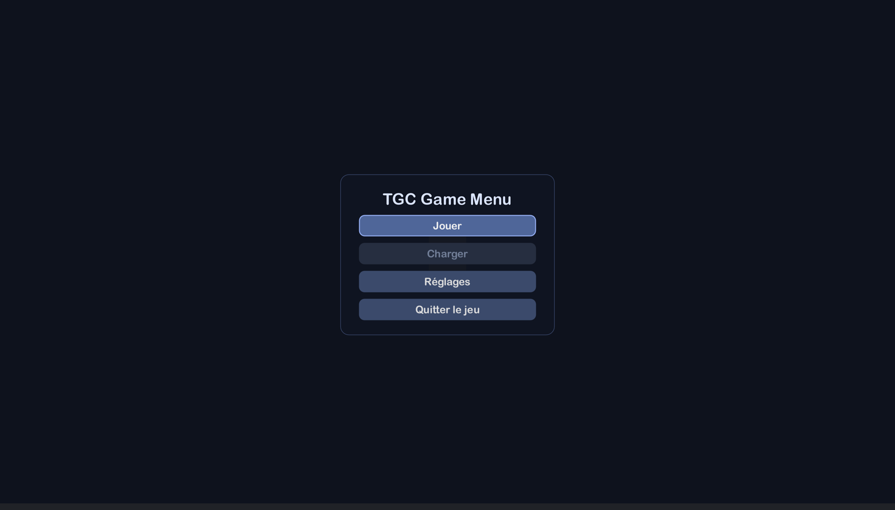
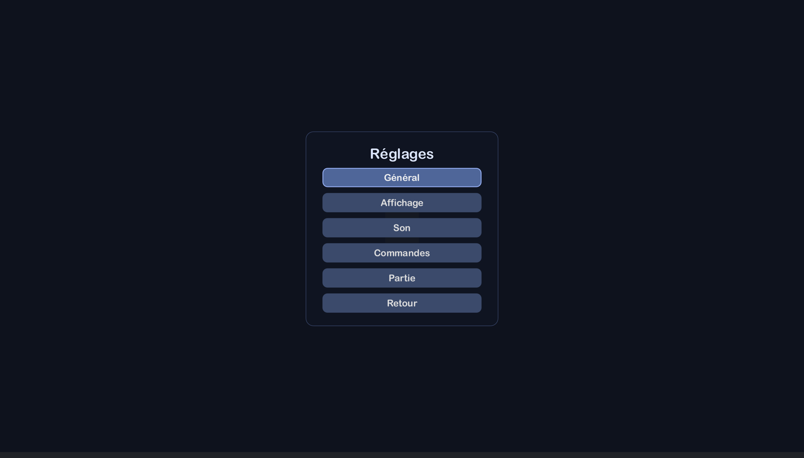
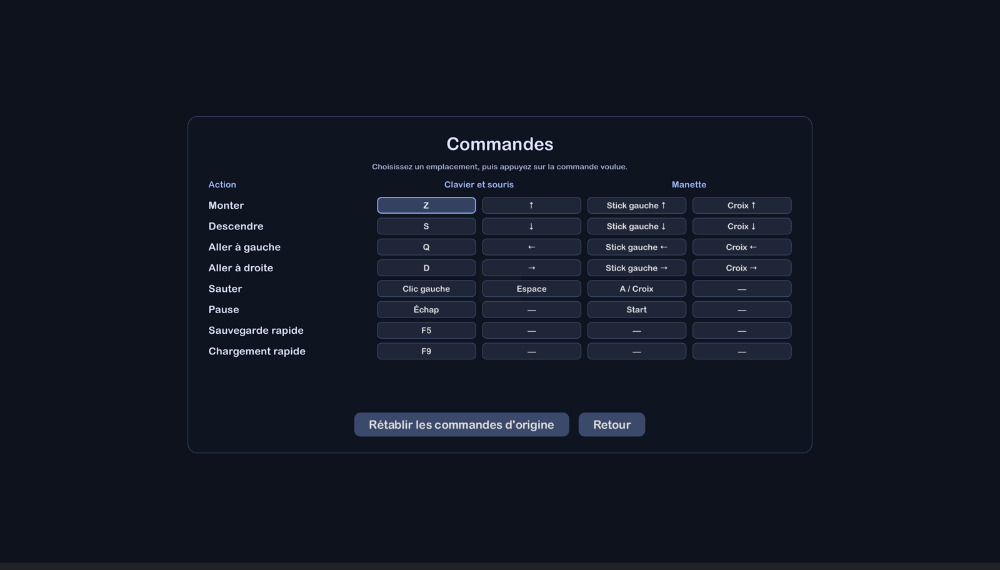
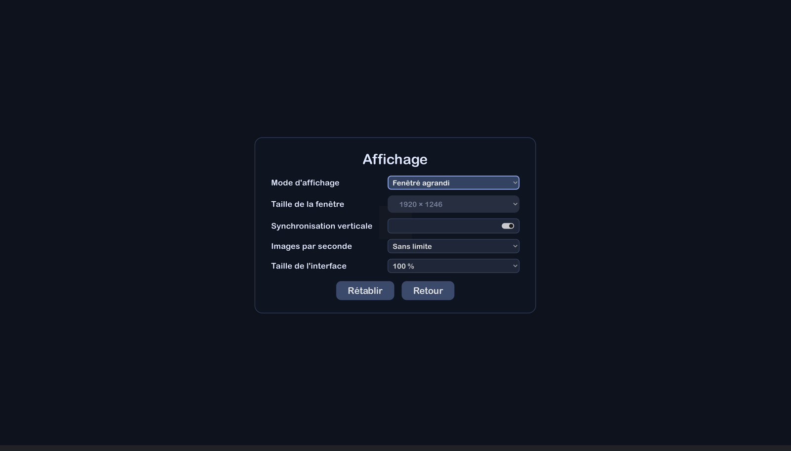
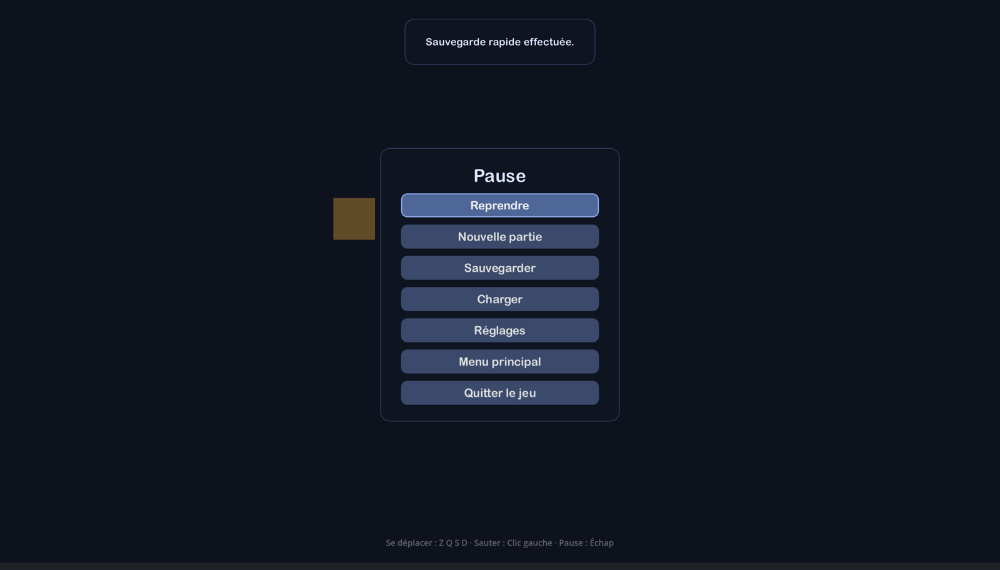
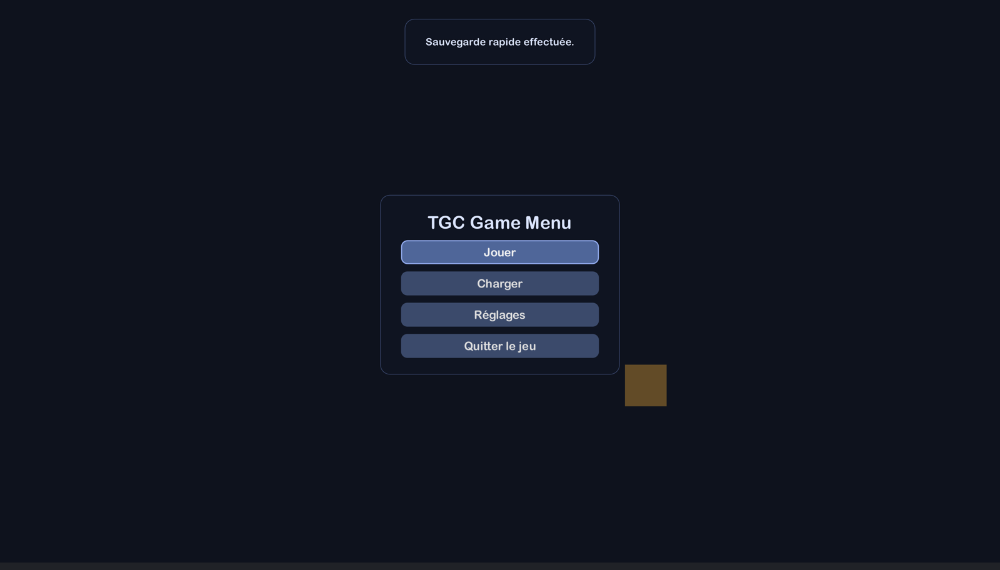
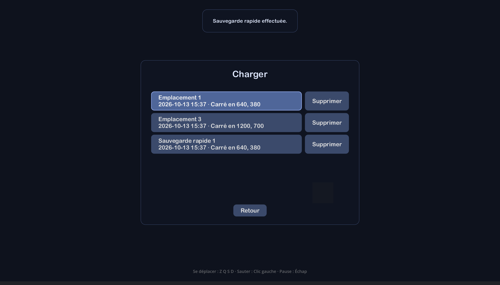
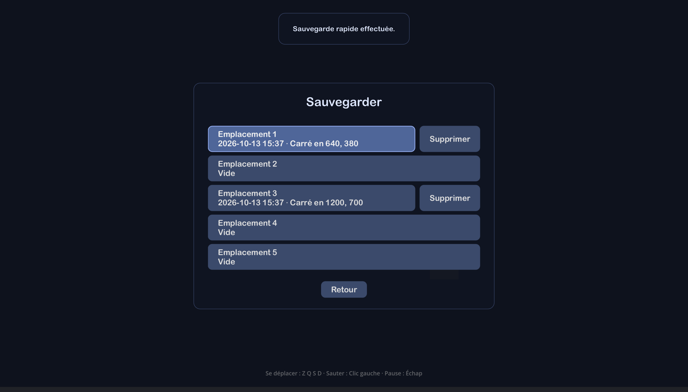
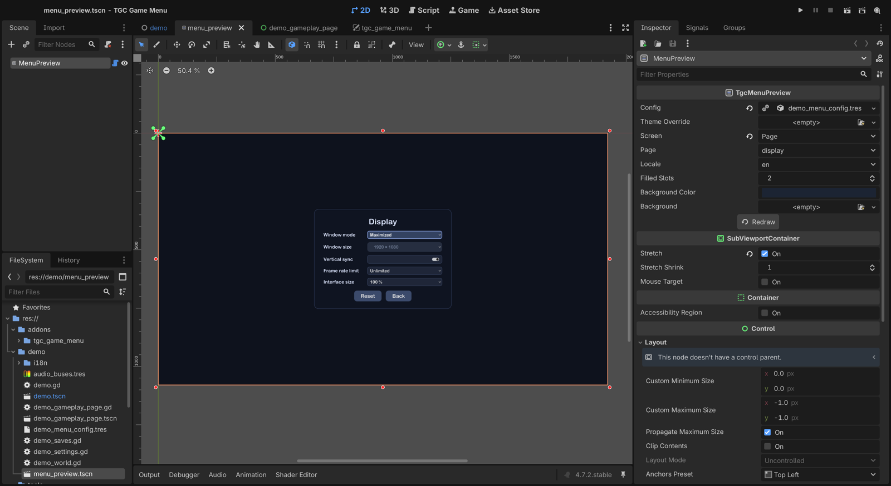

# TGC Game Menu

*[English](README.md)*

**Un menu principal et un menu de pause pour Godot 4, réglés depuis une seule ressource** :
langue, affichage, volume par bus, et commandes clavier, souris et manette remaniables à
l'écran. Les réglages sont enregistrés à chaque changement et relus sans faire confiance au
fichier. En anglais, français, allemand et espagnol.

| | |
| --- | --- |
|  |  |
|  |  |
|  |  |
|  |  |



## Ce qu'il fait

- **Un menu, deux visages** : le menu principal au lancement, le menu de pause pendant une
  partie (Échap, Start, ou la fenêtre qui perd le focus).
- **Un sous-menu Réglages** avec les pages Général, Affichage, Son et Commandes, chaque ligne
  et chaque page facultative, suivies de **vos propres pages**.
- **Un remaniement qui respecte le joueur** : une colonne clavier-souris et une colonne
  manette qui ne se touchent jamais, une touche donnée à une action reprise à celle qui
  l'avait, une pause qui garde toujours une touche, des touches nommées comme elles sont
  gravées sur le clavier du joueur (AZERTY, QWERTZ…).
- **La sauvegarde et le chargement, si vous les voulez** : des emplacements de sauvegarde,
  des sauvegardes rapides sur des raccourcis remaniables (F5, F9), une page Charger qui liste
  vos sauvegardes avec leur date et votre propre résumé, la suppression en option. Votre code
  fait la sauvegarde au travers d'une petite classe ; le menu ne fait que l'appeler.
- **Aucune partie perdue par mégarde** : *Nouvelle partie*, *Menu principal* et *Quitter le
  jeu* demandent d'abord pendant une partie, le focus sur *Annuler*.
- **Seulement les langues de votre jeu** : le menu propose les langues dans lesquelles votre
  jeu est traduit, pas les quatre que parle l'add-on.
- **Un aperçu en direct dans l'éditeur** : choisissez un écran et une langue, modifiez votre
  thème, et voyez le menu changer au fil de la saisie — sans lancer le jeu.
- **Un enregistrement défensif** : un fichier de réglages abîmé retombe sur les valeurs par
  défaut, champ par champ, au lieu de planter le jeu.
- **Aucune dépendance, aucune ressource externe.**

L'intégration tient en un nœud et deux signaux :

```gdscript
func _ready() -> void:
	$MenuSession.game_started.connect($Game.start)
	$MenuSession.game_stopped.connect($Game.stop)
```

La référence complète — installation, chaque option de `TgcMenuConfig`, vos propres pages,
la ligne d'aide qui lit l'Input Map — se trouve dans
[`addons/tgc_game_menu/README.fr.md`](addons/tgc_game_menu/README.fr.md).

## Ce dépôt

C'est un projet Godot 4.7 qui développe et vérifie l'add-on. Seul
`addons/tgc_game_menu/` est le produit ; le reste ne fait pas partie du téléchargement.

| | |
| --- | --- |
| `demo/` | Le plus petit jeu qui utilise l'add-on, avec une page à lui. Lancez le projet. |
| `tools/checks.tscn` | Le banc d'essai, sans fenêtre : `godot --headless --path . res://tools/checks.tscn` |
| `tools/editor_check.gd` | Le banc de l'éditeur : `TGC_EDITOR_CHECK=1 godot --path . --editor` |
| `demo/menu_preview.tscn` | L'aperçu, réglé sur la configuration de la démo. Ouvrez-le dans l'éditeur. |
| `tools/capture.tscn` | Des captures de chaque page, par langue (ouvre une fenêtre). |
| `tools/store_thumbnail.tscn` | La vignette de l'Asset Store (ouvre une fenêtre). `STORE.md` contient le formulaire de la boutique. |
| `tools/install-into.sh` | Copie l'add-on dans un projet, ou l'y met à jour. |

## Licence

MIT — © 2026 Ulric — TheGameCraftsman.
