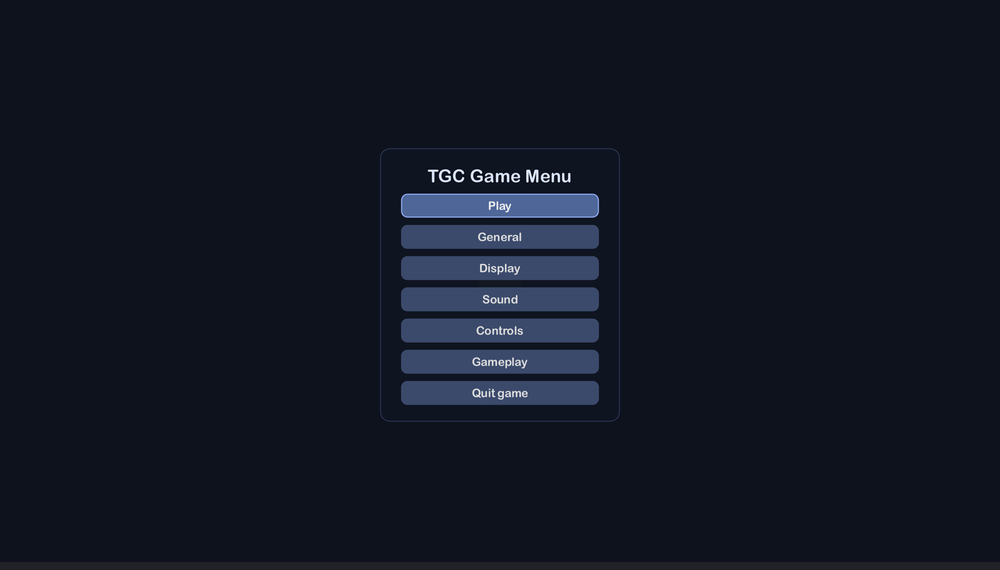
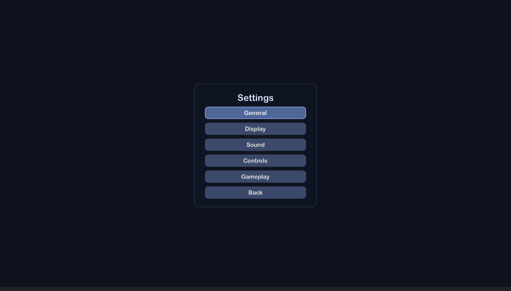
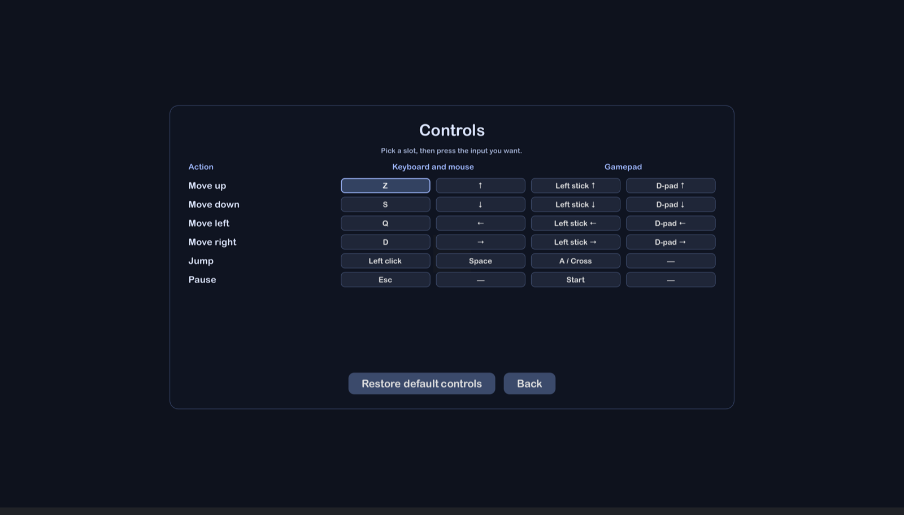
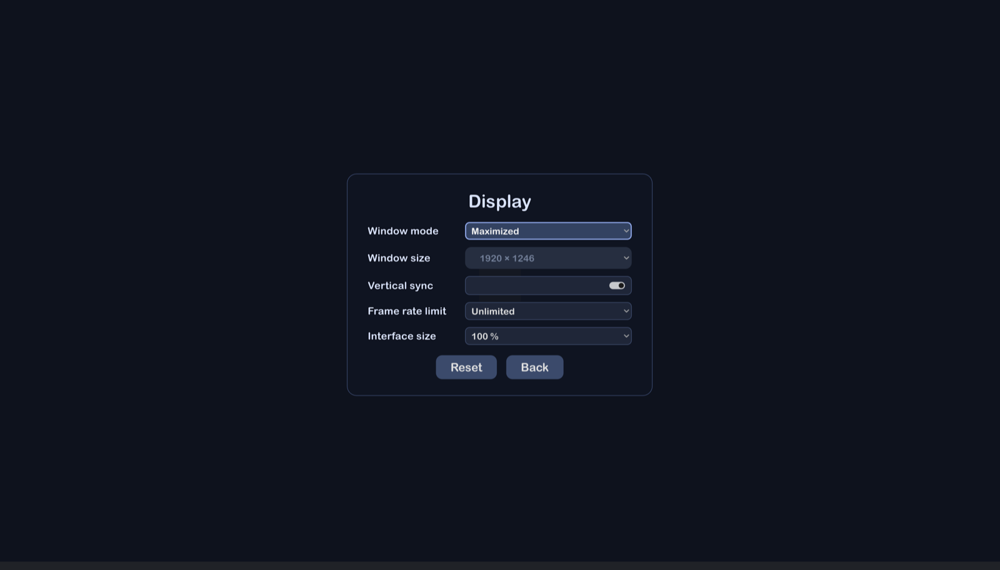
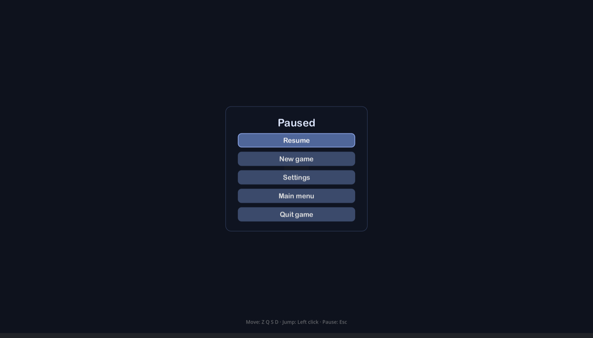
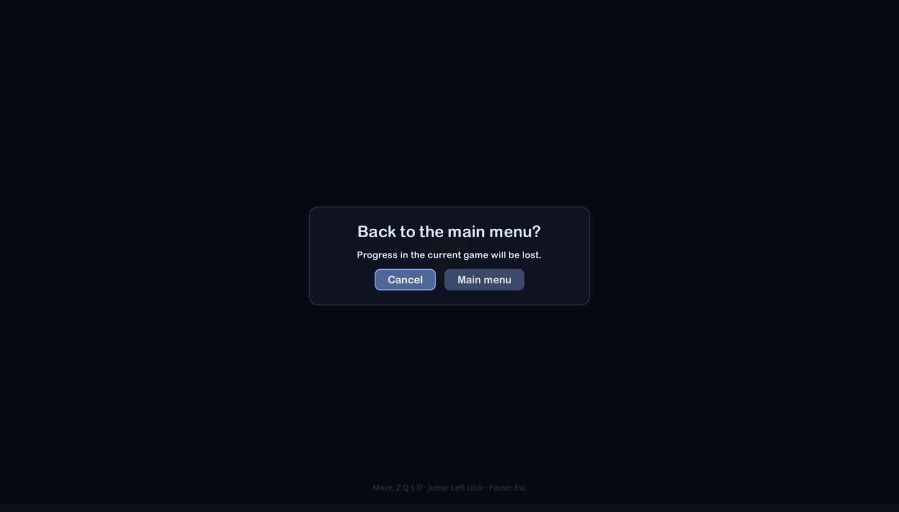
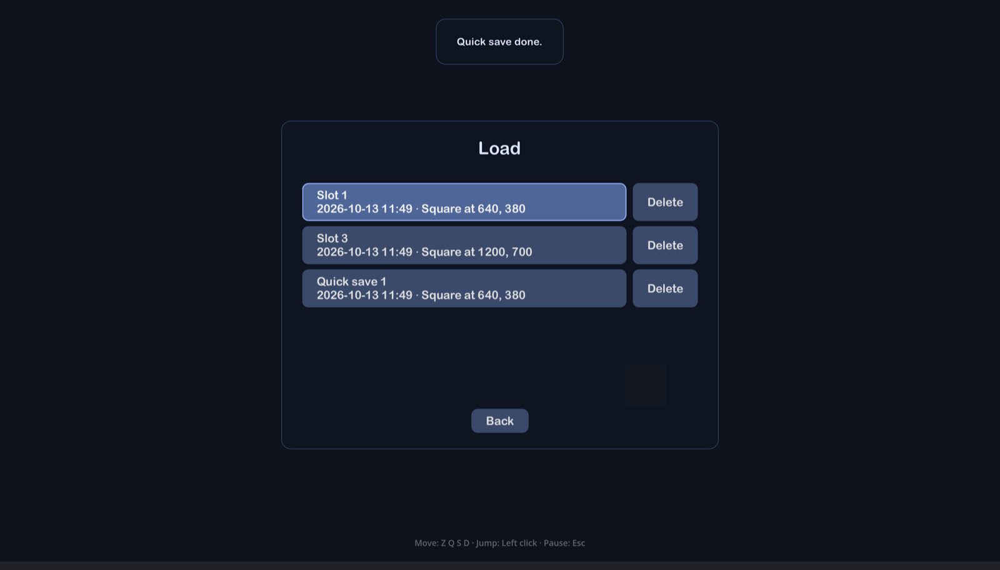

# TGC Game Menu

**A main menu and a pause menu for Godot 4, configured from one resource**: language,
display, volumes per bus, and keyboard, mouse and gamepad controls remapped on screen.
Settings are saved at each change and read back without trusting the file. English,
French, German and Spanish.

| | |
| --- | --- |
|  |  |
|  |  |
|  |  |
|  |  |

## What it does

- **One menu, two faces**: the main menu at start, the pause menu during a game (Esc,
  Start, or the window losing the focus).
- **A Settings sub-menu** with the General, Display, Sound and Controls pages, each row and
  each page optional, plus **your own pages** after them.
- **Remapping that respects players**: keyboard-and-mouse and gamepad columns that never
  touch each other, a key given to an action taken from the one that had it, a pause that
  always keeps a key, keys named as engraved on the player's keyboard (AZERTY, QWERTZ…).
- **Saving and loading, if you want them**: save slots, quick saves on remappable shortcuts
  (F5, F9), a Load page listing your saves with their date and your own summary, optional
  deletion. Your code does the saving through one small class; the menu only calls it.
- **No game lost by mistake**: *New game*, *Main menu* and *Quit* ask first during a game,
  with the focus on *Cancel*.
- **Your game's languages only**: the menu offers the languages your game is translated
  into, not the four the add-on speaks.
- **Defensive saving**: a damaged settings file falls back on the defaults, field by field,
  instead of crashing the game.
- **No dependency, no asset.**

The integration is one node and two signals:

```gdscript
func _ready() -> void:
	$MenuSession.game_started.connect($Game.start)
	$MenuSession.game_stopped.connect($Game.stop)
```

The full reference — install, every option of `TgcMenuConfig`, your own pages, the help
line that reads the Input Map — is in
[`addons/tgc_game_menu/README.md`](addons/tgc_game_menu/README.md).

## This repository

It is a Godot 4.7 project that develops and checks the add-on. Only
`addons/tgc_game_menu/` is the product; the rest is not part of the download.

| | |
| --- | --- |
| `demo/` | The smallest game using the add-on, with a page of its own. Run the project. |
| `tools/checks.tscn` | The bench, headless: `godot --headless --path . res://tools/checks.tscn` |
| `tools/capture.tscn` | Screenshots of every page, per language (opens a window). |
| `tools/install-into.sh` | Copies the add-on into a project, or updates it there. |

## License

MIT — © 2026 Ulric — TheGameCraftsman.
